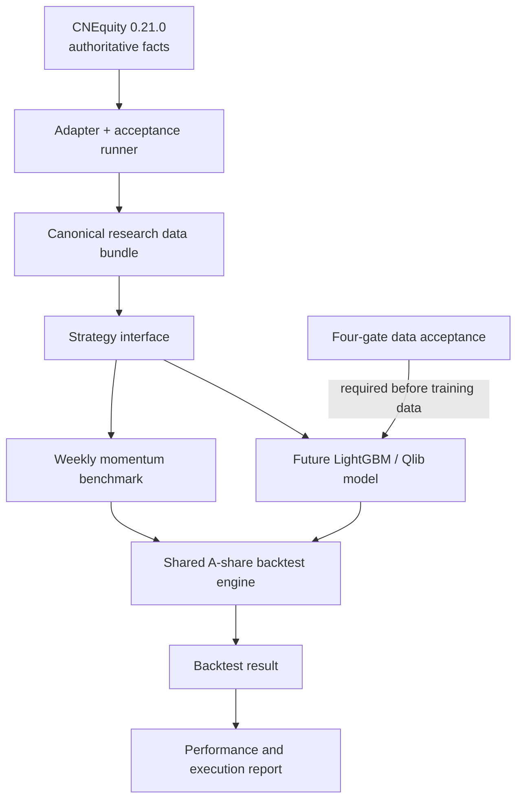

# Research architecture and engineering contract

**Status:** v1 architecture baseline  
**Last updated:** 2026-11-04  
**Repository:** `780662833/ashare-quant-lab`

This document is the system-level reference for implementation decisions. A
design target is not the same as an implemented capability: where code and
design disagree, record the gap, add tests, and update the relevant document.

## 1. Product objective

Build a small, reproducible A-share quantitative **research** system that can
answer three questions:

1. Does a cross-sectional stock-selection strategy have out-of-sample ranking
   ability?
2. Does its excess return survive transaction costs and orders that cannot
   be filled?
3. Is the result stable across different chronological market regimes?

The goal is not to maximize downloaded data volume or deliver automated
trading. CNEquity is the background market-data engineering dependency; the
research platform and its verifiable experiment loop are the primary
development work.

## 2. Frozen v1 scope

| Area | v1 decision |
|---|---|
| Market | Mainland China A-shares; default research universe is CNEquity's documented SH/SZ profile |
| Strategies | One cross-sectional model strategy and one transparent momentum benchmark |
| Portfolio | Top 20, equal-weight targets, no leverage |
| Rebalance | Weekly, on the final supplied exchange session in each ISO week |
| Signal / execution | Signal after close(t); first possible execution is next eligible session's open |
| Research stack | Python, CNEquity 0.21.0, DuckDB, Polars, Qlib, LightGBM |
| Simulation | Project-owned deterministic backtest engine shared by both strategies |
| Outputs | Daily NAV/returns, holdings, order ledger, costs, benchmark comparison, risk report, later walk-forward folds |
| Training gate | Historical universe, HFQ, strict PIT, and trading-status acceptance must all pass for the same window and data revisions |
| Live trading | Explicitly out of scope |

Also out of scope: LLM-generated trading decisions, ETFs, leverage, portfolio
optimizers, multi-strategy orchestration, and a complex dashboard.

## 3. Component boundaries

### CNEquity

- The only authoritative source for historical market, adjustment, universe,
  trading-status, and point-in-time fundamental facts.
- Pinned to `cnequity==0.21.0` until a separately reviewed upgrade.
- Provider-specific calls belong behind the CNEquity adapter and the explicit
  acceptance runner. Strategy and backtest code must not query provider
  internals.
- Downloads may run gradually in the background. An incomplete historical
  lake does not block deterministic engine, report, strategy, or synthetic
  integration work.
- Never create a second market-data source of truth.

### DuckDB and Polars

- DuckDB is the local analytical/query layer; Polars is used for typed,
  deterministic transformations and DataFrame contracts.
- They transform and query CNEquity facts; they do not replace CNEquity as
  the authoritative provider.
- Missing, duplicated, or contradictory facts remain explicit. Do not silently
  forward-fill unexplained gaps.

### Strategy layer

- A strategy consumes canonical research inputs and emits target weights keyed
  by `signal_date` and `instrument`.
- It does not place orders, query the provider, calculate executable prices,
  or change cash/positions.
- The momentum benchmark is deterministic and does not require model training.
- The future model strategy must use the same input and target contracts.

### Backtest engine

- One engine owns execution, cash, positions, order states, costs, and NAV.
- Momentum and model targets pass through the same engine and configuration.
- Raw OHLC is used for execution. HFQ adjusted prices are research-only.
- No-fill and partially filled orders remain in the ledger; the system must
  not replace unfilled selections with securities that later performed better.

### Report layer

- Consumes `BacktestResult`; it does not read market data or modify accounting.
- Strategy and benchmark must be aligned on their common observed window.
- Positive excess return is descriptive evidence, not proof of significance
  or future profitability.

### Qlib and LightGBM

- Optional research dependencies, not prerequisites for current synthetic
  backtest and momentum development.
- Qlib may be reused for feature workflow, dataset handling, model training,
  and prediction where its contracts fit.
- A-share universe, PIT availability, exchange execution, costs, and order
  fills remain project-owned and must not be delegated to generic defaults.
- No model fit or training dataset build is permitted before the four-gate
  acceptance contract is passed and enforced by a future builder.

## 4. Canonical data and time contract

### Keys and dates

- Security key: exchange-qualified identifier such as `600000.SH`.
- Market date: exchange-local trading date.
- Primary panel key: `(instrument, date)`; duplicates are a hard error.
- Signal date: session whose close is available to the strategy.
- Execution date: next eligible exchange session, never the same close.
- Fundamentals carry both report period and publication/availability time.
  Report period is not a substitute for when a fact became knowable.

The future research bundle must use the official exchange calendar. Do not
infer calendar sessions from the dates on which one selected stock happened
to trade.

### Price roles

| Price field | Allowed use |
|---|---|
| Raw `open/high/low/close` | Execution simulation and explicitly defined marking |
| HFQ `adj_*` | Historical return and research feature calculations |
| Raw close as a momentum feature | Not allowed |
| Adjusted price as a fill price | Not allowed |

HFQ factor coverage and economic adjustment correctness are separate checks.
An `adj_is_exact` flag or successful strict-adjust query alone is not a
third-party accuracy certification.

### Universe and availability

- Universe membership is point-in-time on every signal date.
- Historical listing/delisting, ST/risk-warning, exchange, and board history
  must not be reconstructed from today's listed names.
- Delisted securities remain in historical research where they were eligible.
- Fundamental facts use strict as-of availability. Revisions must not rewrite
  what was knowable at an earlier decision timestamp.
- Empty strict PIT output is a coverage failure, not permission to use
  best-effort mode.

### Separate signal data from execution evidence

The canonical research bundle must carry separate inputs:

1. Adjusted price panel for signals/features.
2. Historical point-in-time membership by signal date.
3. Raw OHLC panel for execution and marking.
4. Official exchange trading calendar.
5. Historical suspension, risk-warning, and trading-status evidence.
6. Price-limit values and limit-lock evidence for execution sessions.
7. Source receipts, data revisions, and applicable acceptance-report identity.

One type of price or one source field must not be silently substituted for
another.

## 5. Four non-bypassable data acceptance gates

All four gates are required before any model-training dataset can be built.
They must pass for the **same requested window, universe profile, and source
data revisions**.

| Gate | Required evidence | Fail-closed behavior |
|---|---|---|
| Historical universe | Historical membership, listing/delisting, ST evidence, interior session coverage, delisted-name/survivorship checks | Missing scope or receipts = FAIL |
| HFQ adjustment | Strict HFQ output, factor coverage, revision-bound historical factor/corporate-action diagnostics | Missing factors, unassessed diagnostics, unresolved contradictions = FAIL |
| PIT fundamentals | Non-empty `pit_mode="strict"` result, exact PIT evidence, `pit_quality="strict"`, requested symbol/item coverage, announcement no later than as-of | Empty, reconstructed, incomplete, or future-published fact = FAIL |
| Trading status | Status evidence and known risk-warning state for observed positive-volume SH/SZ bars, with contradictions surfaced | Missing or contradictory evidence = FAIL |

Important scope notes:

- Current trading-status acceptance is scoped to observed positive-volume SH/SZ
  bars. It is **not** a complete instrument-by-calendar matrix proving every
  suspension/non-trading date.
- Historical-universe and HFQ diagnostics are bounded by evidence from the
  pinned CNEquity release and the exact query receipt.
- Four-gate PASS is necessary but not sufficient to unlock training.
  `training_dataset_unlocked` remains false until a future builder verifies
  report identity, window, profile, and revisions and stores them with the
  dataset.
- A pure price-momentum benchmark does not consume fundamental PIT features;
  it still requires valid historical membership, adjusted-price evidence,
  exchange calendar, and execution-state evidence. This does not authorize
  model training.

See [data_contract.md](data_contract.md) for the operational contract.

## 6. Trading and accounting contract

The current engine implements a deterministic first slice:

- Close(t) signal, next supplied row-date open execution.
- Explicit suspension, limit-up lock, and limit-down lock flags are mandatory.
- Supplied price limits must be positive; an open inconsistent with a supplied
  limit is rejected.
- Sells are attempted before buys.
- Buy quantities are rounded down to 100-share lots by default.
- No leverage or negative cash; unaffordable buys are reduced by whole lots.
- Commission/minimum commission, sell stamp duty, transfer fee, and slippage
  are reflected in filled prices/cash once; slippage is not double deducted.
- Missing bars and blocked orders remain visible as no-fill records.
- Existing positions remain when a sell cannot execute.
- Daily NAV is cash plus marked positions.

This is **not yet a full historical exchange simulator**. Known gaps include
T+1 availability/settlement enforcement, a validated historical price-limit
rule/evidence provider for board- and date-specific limits and IPO no-limit
windows, corporate-action share/cash adjustments, historical odd-lot
liquidation rules, and a full security-by-calendar status matrix. CNEquity
0.21.0 native trading_status does not supply the limit prices or lock flags. Do not describe results as production-grade A-share simulation until
these are implemented and tested.

Configured costs are experiment assumptions, not a statement of current
broker/exchange schedules. Record the exact configuration for every run.

See [backtest_rules.md](backtest_rules.md) and
[backtest_report.md](backtest_report.md).

## 7. Momentum benchmark contract

The first benchmark is a weekly, cross-sectional, top-20 equal-weight
momentum portfolio:

`score(t) = HFQ_close(t - 21 sessions) / HFQ_close(t - 126 sessions) - 1`

- Rank descending, with deterministic symbol tie-breaking.
- Use membership as-of the signal date.
- Require exact endpoint prices; exclude a candidate missing either endpoint.
- Do not forward-fill missing prices or substitute raw close.
- Emit target weights only; execute through the shared engine next session.
- With fewer than 20 valid names, divide target weight equally among those
  names. An empty valid set produces no targets.

See [momentum_benchmark.md](momentum_benchmark.md).

## 8. Experiment comparability and reporting

Model and benchmark runs must use identical:

- Historical universe and date window.
- Exchange calendar and weekly signal dates.
- Engine version and execution configuration.
- Raw OHLC and status/price-limit evidence.
- Cost assumptions and initial capital.
- Portfolio size, weighting, and no-leverage rule.
- NAV marking and report calculations.

Every run should retain strategy parameters, repository commit, package
versions, data receipts/revisions, requested window, universe profile,
execution/cost configuration, and random seed where applicable.

Report total return, CAGR, annualized volatility, Sharpe, maximum drawdown,
gross turnover, fill ratio, no-fill counts, itemized fees plus slippage cost,
and benchmark excess return over the same common window. Walk-forward work must report
fold-level and regime-level results, not only pooled headline metrics.

## 9. Development discipline

- Synthetic fixtures are the default for deterministic engine/strategy tests.
- CI passing synthetic tests does not certify the local CNEquity lake.
- Real-lake acceptance runs against the user's configured local data root and
  produces a separate evidence report.
- Data acquisition is not a blocker for pure research-engine development, but
  missing data cannot be bypassed for empirical claims or model training.
- Do not repeatedly ask the user to run large downloads for ordinary code
  changes.
- Do not claim local commands, tests, acceptance, or backtests ran unless the
  corresponding environment actually executed them.

## 10. Current maturity snapshot

As of 2026-11-04:

| Capability | State |
|---|---|
| CNEquity 0.21 adapter and four-gate acceptance | Implemented; real-lake gates require local evidence |
| Deterministic first-slice backtest engine | Implemented; exchange-simulation gaps remain |
| Performance/execution report | Implemented; itemized commission, transfer fee, stamp duty, and separately attributed slippage on Phase 7 branch |
| Weekly momentum score/targets | Merged; canonical bundle orchestration on open PR #10; real CNEquity-to-limit-evidence input remains pending |
| Unified research data bundle | PR #10 open (CI passed); core builder, momentum orchestration, and native CNEquity status normalization included; external historical price-limit evidence provider and local-lake validation remain pending |
| Walk-forward fold planner | PR #11 open and stacked on PR #10 (CI passed); plans folds only, does not train/evaluate models |
| Feature/label builder and LightGBM/Qlib training | Not implemented; gated by four-gate acceptance |
| Live trading | Out of scope |
